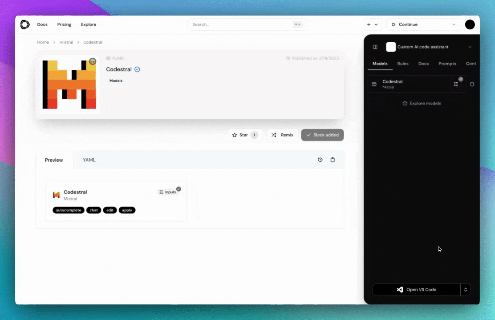
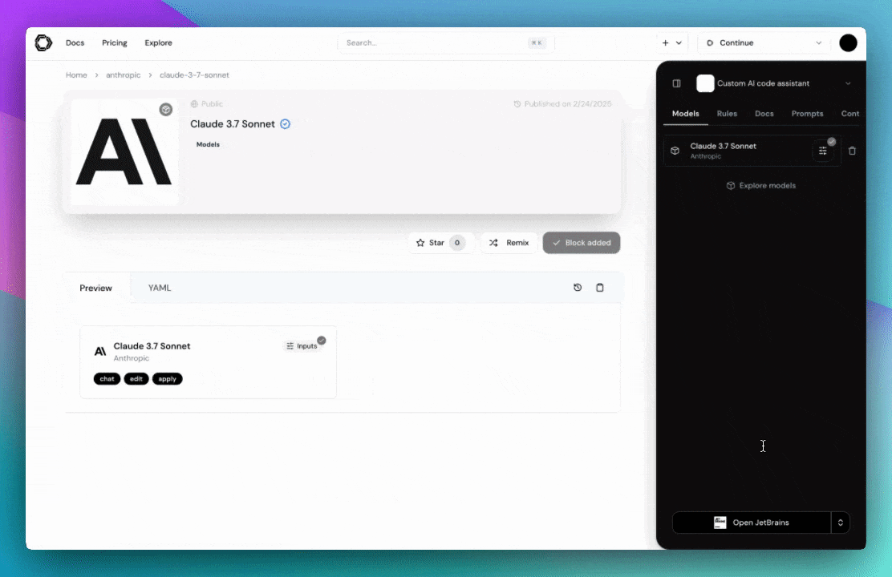
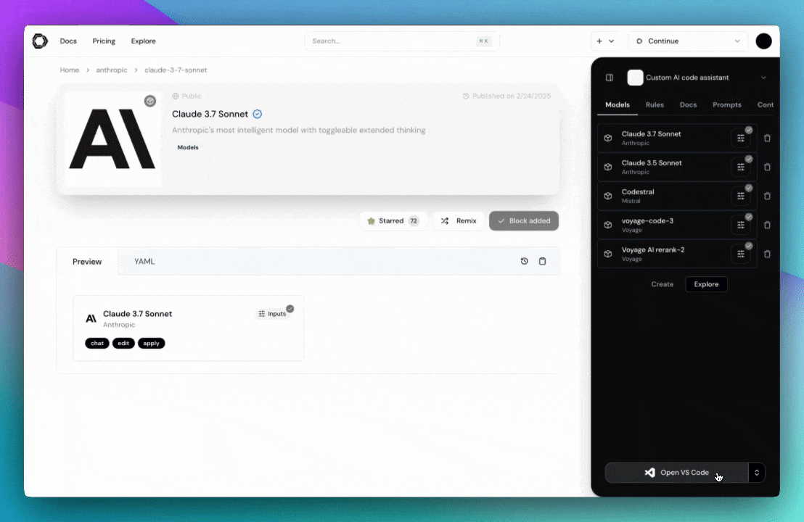

<h2 align="center">Continue 613</h2>

<strong >Continue 613 </strong>

מאפשר למתכנתות ליצור, לשתף, ולהשתמש בסוכני AI.   
זהו תוסף מבוסס קוד פתוח שעבר תהליך של סינון hard-coded כדי להבטיח צ'אט נקי  , מקצועי ויעיל.

כרגע התוסף מאפשר שימוש במודלים לבחירה. המשתמש צריך ליצור חשבון ו-api key ולאחר מכן להוסיף לרשימת המודלים.

ותח על ידי AVIGAIL BERK ו־ SH. TEPP.

📩
פניות ודיווח על באגים ניתן לשלוח לכתובת: sh0504128171@gmail.com או לפלאפון : 050-4128171

🛒
להזמנת מוצרים מבוססי AI מותאמים אישית, ניתן לפנות ל־ אביגיל ברק - abigail506040@gmail.com

<h2 align="center">Continue</h2>

**[Continue](https://docs.continue.dev) enables to developers create, share, and use custom AI code assistants with our open-source [VS Code](https://marketplace.visualstudio.com/items?itemName=AutoDidact613.continue613) extension and [hub of models, rules, prompts, docs, and other building blocks](https://hub.continue.dev)**

## Chat

[Chat](https://continue.dev/docs/chat/how-to-use-it) makes it easy to ask for help from an LLM without needing to leave the IDE

## Autocomplete

[Autocomplete](https://continue.dev/docs/autocomplete/how-to-use-it) provides inline code suggestions as you type

## Edit

[Edit](https://continue.dev/docs/edit/how-to-use-it) is a convenient way to modify code without leaving your current file

## Agent

[Agent](https://continue.dev/docs/agent/how-to-use-it) enables you to make more substantial changes to your codebase

## License

[Apache 2.0 © 2023-2024 Continue Dev, Inc.](./LICENSE)
